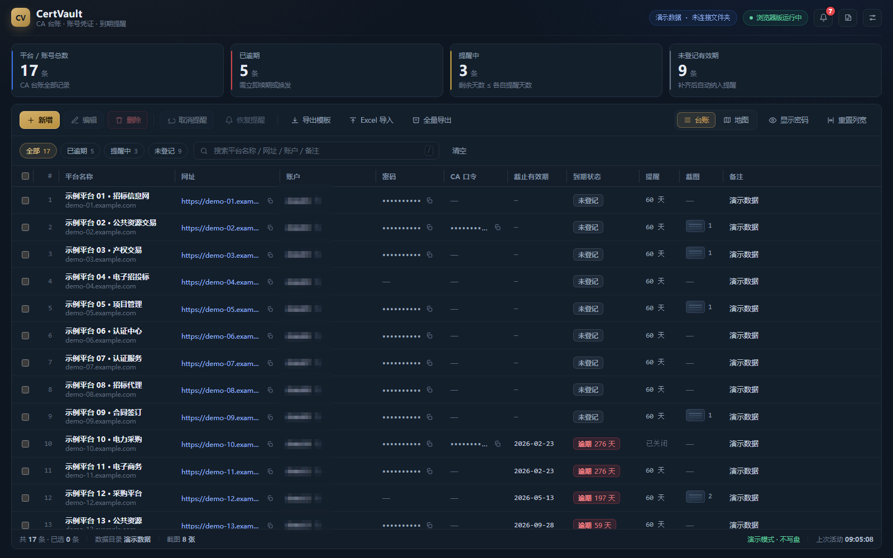
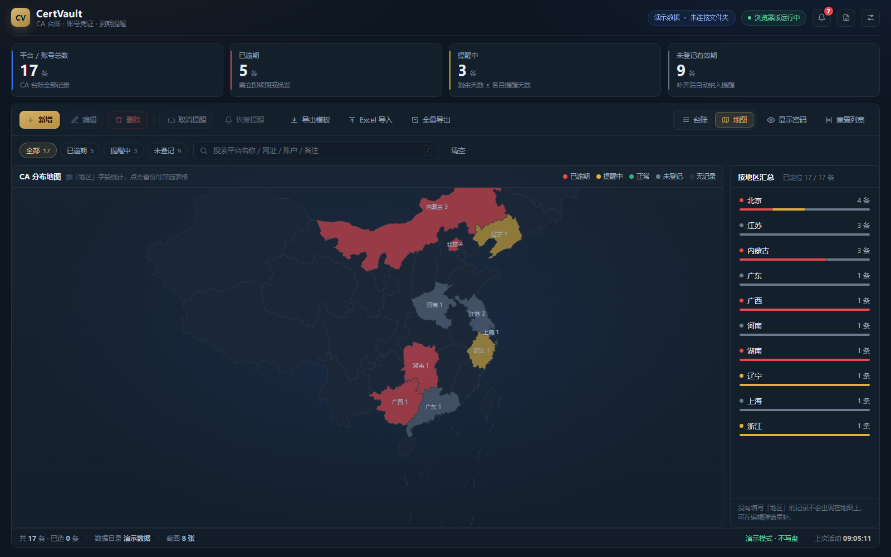
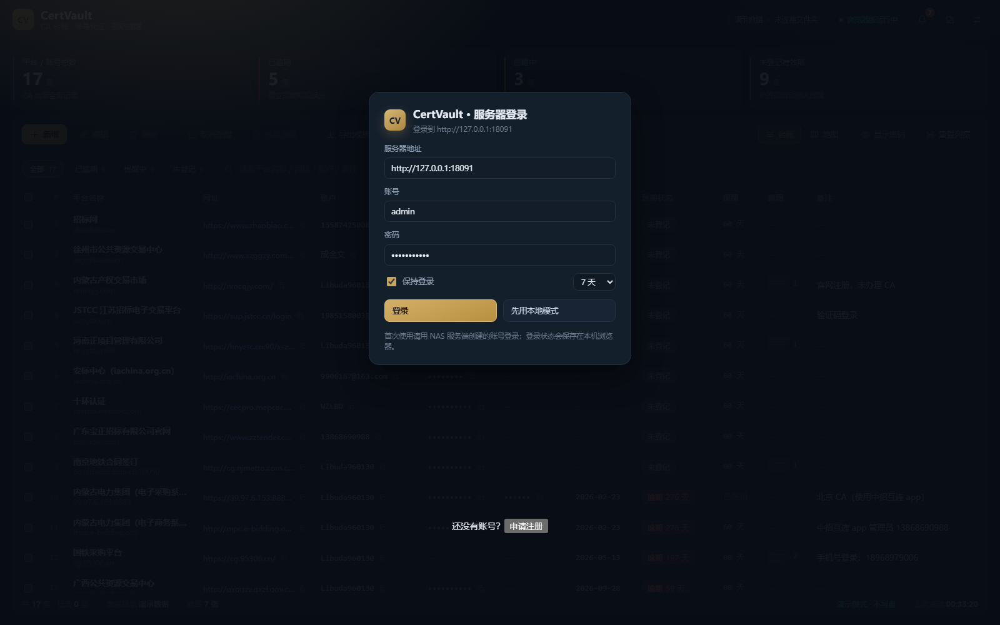

# CertVault · CA 台账与到期提醒

公司 CA 证书 / 平台账号的统一台账：一屏看清哪些要续费、哪些已逾期，凭据和证书截图放在同一条记录里。自带两个形态：**Windows 桌面版**（单机、免安装运行时）和 **服务器版**（NAS/Docker + 浏览器登录，多人共享同一份数据）。

| 形态 | 运行方式 | 适合 |
|---|---|---|
| 桌面版 | `CertVault.exe`（C# + WebView2 壳） | 一个人一台电脑，数据放在本地文件夹或网盘同步目录 |
| 服务器版 | `docker compose up -d`，浏览器访问 `http://NAS-IP:8090` | 多人共用一份台账，带账号、角色、审批与操作日志 |

## 下载

不想自己构建的话，直接取 [Releases](https://github.com/Yix0109/CertVault/releases/tag/v1.0) 里的两个包：

- `CertVault-Desktop-v1.6.zip` —— 桌面版，解压后双击 `CertVault.exe` 即用（Win10/11，含 WebView2 运行时依赖说明）
- `CertVault-Server-v1.0.zip` —— 服务器版，解压后读 `开始部署.txt`，按 `docs/部署-NAS.md` 在 NAS 上 `docker compose up -d`

GitHub 会把包名里的中文替换成 `-`，所以发行包用英文名；解压后目录仍是 `CertVault-桌面版\` / `CertVault-数据\` / `CertVault-服务器版\`。

## 截图

台账主界面（账户列已打码，页面内为合成演示数据）：



按地区汇总的离线地图（ECharts + 省级 GeoJSON，无外网、无地图 Key）：



服务器版登录页：



## 功能

### 台账

- 9 个字段：平台名称、网址、账户、密码、CA 证书口令、截止有效期、提醒天数、地区、备注；每条记录可挂 **最多 8 张截图**（证书扫描件、平台操作截图）
- 剩余天数由截止日期自动计算，状态三档：**已逾期 / 提醒中（0 ≤ 剩余 ≤ 提醒天数）/ 未登记**
- 顶部 KPI 卡（总数、已逾期、提醒中、未登记）**可点击直接筛选**，与状态标签页联动
- 密码、CA 口令默认掩码，可临时显示、单格复制；行右键菜单支持复制各字段
- 列宽可拖动、双击表头复位、工具栏一键复位，列宽写入设置下次仍生效
- 详情抽屉：基础信息、凭据、提醒、附件与备注分卡展示

### 提醒

- 打开软件即检查，之后每 15 分钟轮询一次；T-7 / T-3 / T-1 与逾期每日提醒，带冷却时间避免反复弹窗
- 单条可「取消提醒 / 恢复提醒」，不影响台账状态

### Excel 导入导出

- 导出 `.xlsx`：9 列表头 + 动态截图列，**截图以图片形式内嵌在单元格里**（两单元格锚点，OpenPyXL/Excel/WPS 均可读）
- 导入前先出**预检**：新增 N 条、覆盖 N 条（逐字段显示 旧值 → 新值，密码类只显示「已填写」）、错误明细（第 N 行为什么被跳过），确认后才落盘
- 按「网址 + 账户」判重；空值不覆盖已有值；坏行逐行跳过，不整批失败；导入前自动备份
- 空模板导出、UTF-8 BOM、防公式注入

### 地图

- 完全离线：ECharts + DataV 省级 GeoJSON，按记录的「地区」字段聚合配色对应最严重状态
- 右侧按地区汇总，点省份可下钻看该地区的记录明细，再点一条直接打开详情
- 编辑记录时「地区」可输入搜索（打「内蒙」出「内蒙古」），也可按平台名称自动识别

### 服务器版（多用户）

- 账号体系：`admin`（管账号）/ `editor`（可编辑）/ `viewer`（只读），viewer 的写入口在界面上锁定，服务端 403 兜底
- 注册审批：同事自助申请 → 管理员通过/拒绝（可填原因）→ 通过后即可登录；支持改角色、停用启用、重置密码
- 操作日志：谁在什么时候改了哪条记录，可按人、动作、时间筛选；审计保留最近 5000 条
- 并发保护：`If-Match` 版本校验，两人同时改同一条时后者 409 被拦，不会静默覆盖
- 令牌：HMAC 签名 Bearer + Cookie 双通道，TTL 可配（默认 7 天），登出立即失效，吊销记录落盘（重启后旧令牌仍无效）
- 图片上传：单张 ≤ 8 MB、每条 ≤ 8 张，整请求上限 80 MB

## 快速开始

### 桌面版（Windows 10/11）

1. 解压发行包，得到 `CertVault-桌面版\` 与 `CertVault-数据\` 两个文件夹
2. 双击 `CertVault.exe`，首次启动选择数据文件夹（可以直接选 `CertVault-数据`，也可以放网盘同步目录）
3. 数据全部在这个文件夹里：`data\certvault.json`、`images\`、`backup\`，整个文件夹拷走即搬家

也可以从源码用浏览器打开 `app/index.html`（无宿主时走浏览器存储 + 手动选择数据文件夹）。

### 服务器版（Docker / 飞牛 NAS）

```bash
# 1) 代码放到 NAS：/vol2/1000/8#Docker/CertVault/srv/{server,app,deploy,.dockerignore}
# 2) 建数据目录并归位权限
sudo mkdir -p "/vol2/1000/8#Docker/CertVault/data"
sudo chown -R 1000:1000 "/vol2/1000/8#Docker/CertVault/data"

# 3) 写口令
cd "/vol2/1000/8#Docker/CertVault/srv/deploy"
sudo cp certvault.env.example certvault.env
sudo nano certvault.env        # 必填 CV_USER / CV_PASS
sudo chmod 600 certvault.env

# 4) 启动
docker compose -f "/vol2/1000/8#Docker/CertVault/srv/deploy/docker-compose.yml" up -d --build
```

浏览器打开 `http://<NAS-IP>:8090/`，用 `CV_USER` / `CV_PASS` 登录，然后到「账号管理」给同事建账号。

路径里的 `#` 会被 shell 截断，命令行中必须加引号。完整手册（HTTPS、Tailscale、备份、升级回退、桌面版数据迁移）见 [docs/部署-NAS.md](docs/部署-NAS.md)。

## 仓库结构

```
app/              前端（原生 JS，无构建步骤）
  core.js         数据模型、CSV/Excel 列定义、地区识别
  store.js        文件系统存储（File System Access / 宿主桥）
  store-http.js   服务器模式存储适配器（与 store.js 同签名）
  app.js          渲染、交互、导入预检、地图、列宽、提醒
  excel.js        xlsx 导入导出（SheetJS + 内嵌截图）
  server-endpoints.js  服务器地址探测与会话管理
  admin-ui.js     账号管理 / 操作日志 / 注册审批（服务器模式）
  bridge.js       桌面宿主文件桥（页面侧）
server/           Node 零依赖 API（node:http/fs/crypto）
desktop/          C# WinForms + WebView2 外壳源码与构建脚本
deploy/           docker-compose、Dockerfile、env 模板、nginx 示例、备份脚本
docs/             部署手册、接口契约、验收清单、使用说明
tests/            单元测试（node --test）
scripts/          冒烟与端到端脚本（api-smoke、e2e-server、浏览器验收）
samples/          导入示例 CSV
screenshots/      README 用截图（合成演示数据）
```

## 技术栈

- 前端：原生 JavaScript + CSS（无框架、无打包，SheetJS 处理 xlsx，ECharts 渲染地图，DataV GeoAtlas 提供省级边界
- 桌面壳：C# WinForms + WebView2（.NET Framework 4.x，csc 编译，无需安装 .NET SDK）
- 服务端：Node 20，零第三方依赖，scrypt 存口令、HMAC 签令牌、multipart 收图
- 部署：Docker Compose（单容器 + 数据卷），可选 nginx 反代 + HTTPS

## 数据与安全

- 台账数据以 JSON 明文存放（`data/certvault.json`），图片按记录分目录存放；**没有字段级加密**，安全性依赖磁盘/卷权限与设备本身，请勿把数据目录同步到不受控的位置
- 服务器版账号口令用 `scrypt` 加盐哈希，只存哈希；令牌密钥由服务端环境变量派生
- 仓库里**不含任何真实数据**：`.gitignore` 排除 `数据/`、`build/`、`dist/`、`deploy/certvault.env`；页面内置的 17 条演示数据全部为合成数据（`示例平台 01`、`demo01`、`demo-pass-01`）

## 开发与测试

```bash
node --test tests/core.test.mjs tests/store.node.test.mjs   # 单元测试（31 例）
node server/server.js                                        # 本地起服务，默认 8080
node scripts/api-smoke.mjs http://127.0.0.1:8080            # 接口冒烟（122 条断言）
node scripts/e2e-server.mjs http://127.0.0.1:8080           # 接口端到端（84 条断言 / 30 个端点）
```

桌面壳编译（需要 .NET Framework 4.x 自带的 `csc.exe` 与 WebView2 SDK 两个 DLL）：

```powershell
powershell -ExecutionPolicy Bypass -File desktop/build-desktop.ps1
```

## 版本

| 版本 | 内容 |
|---|---|
| 服务器版 v1.0 | 服务端 API、登录与多用户、注册审批、操作日志、服务器地址簿、Docker 部署 |
| 桌面版 v1.6 | 单机台账、Excel 内嵌截图、地图与地区筛选、导入预检明细、KPI 筛选、列宽拖动、备份保留 |

## 许可

内部工具，未附开源许可证。需要对外分发请先补充许可证与数据合规说明。